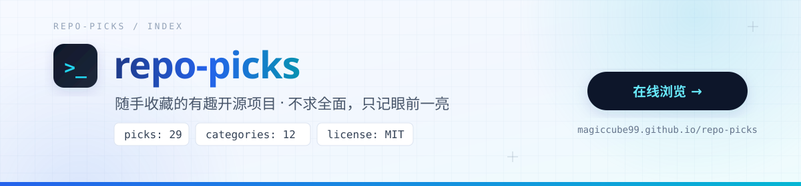

  

  <a href="https://magiccube99.github.io/repo-picks/"><b>🌐 在线浏览</b></a>
  &nbsp;·&nbsp; 当前收录 <b>6</b> 个项目 / <b>4</b> 个分类 / MIT License

---

## 目录
- [🤖 智能体与 Agent 技能](#-智能体与-agent-技能)
- [🧠 大模型与推理引擎](#-大模型与推理引擎)
- [🌐 云原生与实用服务](#-云原生与实用服务)
- [💻 桌面端与跨平台框架](#-桌面端与跨平台框架)

---

## 🤖 智能体与 Agent 技能

共 3 个项目（点击展开）

 

| 项目 | 核心干啥的 | 亮点 / 为什么收录 |
| :--- | :--- | :--- |
| [affaan-m/ECC](https://github.com/affaan-m/ECC) `JavaScript`  | 面向 Claude Code 等智能体的技能与架构调优框架。 | 模块化 Instincts 与上下文调优 |
| [dmoshehun-prog/learn-from-materials](https://github.com/dmoshehun-prog/learn-from-materials) `Python`  | 将书籍论文转为可追溯、测验的互动学习网页。 | 跨 Agent 规范，深度溯源防幻觉 |
| [zenstory-ai/novel-to-game](https://github.com/zenstory-ai/novel-to-game) `Markdown`  | 驱动 Agent 通读拆书并将小说自动改编为可玩游戏。 | 策划开发盲玩全链路技能闭环 |

## 🧠 大模型与推理引擎

共 1 个项目（点击展开）

 

| 项目 | 核心干啥的 | 亮点 / 为什么收录 |
| :--- | :--- | :--- |
| [JustVugg/colibri](https://github.com/JustVugg/colibri) `C`  | 分层调度显存、内存与磁盘，让普通设备跑超大 MoE。 | 纯 C 编写，零门槛跑百亿参数模型 |

## 🌐 云原生与实用服务

共 1 个项目（点击展开）

 

| 项目 | 核心干啥的 | 亮点 / 为什么收录 |
| :--- | :--- | :--- |
| [maillab/cloud-mail](https://github.com/maillab/cloud-mail) `JavaScript`  | 基于 Cloudflare 的一站式自托管邮箱收发平台。 | 零服务器成本，自带 Web 客户端 |

## 💻 桌面端与跨平台框架

共 1 个项目（点击展开）

 

| 项目 | 核心干啥的 | 亮点 / 为什么收录 |
| :--- | :--- | :--- |
| [egoist/mygo](https://github.com/egoist/mygo) `Go`  | 用 Go 开发轻量原生 UI 或 Webview 桌面应用。 | 纯 Go 自绘原生界面，极速启动 |

